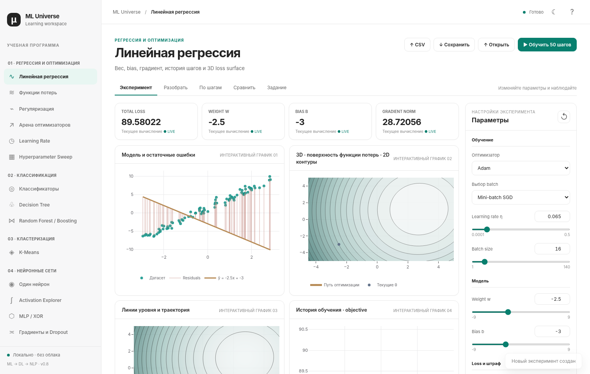

# ML Universe — ML → Deep Learning → NLP

**Интерактивная офлайн-лаборатория** для изучения машинного обучения, нейросетей и NLP. Основная платформа — **Linux**; Windows-скрипты и сборка `.exe` сохранены на будущее.



[Тёмная тема](docs/ui-dark.png) · [Руководство по лабораториям](docs/LEARNING_GUIDE.md) · [Матрица реализации](docs/IMPLEMENTATION_MATRIX.md)

> Версия **0.8.0 — Focused Curriculum**. Это набор настоящих вычислительных учебных лабораторий, а не реализация полного DL/NLP-фреймворка. Обучение большой LLM, полноценный генеративный RAG и trainable CNN/RNN **не выдаются за работающие функции**. Небольшие архитектуры и математические операции доступны для экспериментов.

## Запуск на Linux

Требуется **Python ≥3.11**, `venv`, браузер и интернет **только для первой установки зависимостей**.

```bash
git clone https://github.com/junimenkoroman-collab/ML-universe.git
cd ML-universe
./scripts/run_linux.sh
```

Скрипт создаёт `.venv`, устанавливает NumPy/SciPy/scikit-learn и запускает приложение **локально** (`127.0.0.1`). Графики Plotly встроены в проект; внешний веб-сервис не нужен.

Если репозиторий уже скачан и хочется получить мою новую версию:

```bash
cd ML-universe
git pull --ff-only
./scripts/run_linux.sh
```

Если локально менял код, сначала сохрани изменения в отдельной ветке/коммите, чтобы `git pull` не затёр работу. `git pull` не нужен при каждом запуске: только после новых коммитов.

Если браузер не открылся автоматически:

```bash
.venv/bin/python -m ml_universe --no-open --port 8765
```

Открой **http://127.0.0.1:8765/** на том же Linux-компьютере.

## Учебные разделы — только необходимое

Навигация сгруппирована в **7 этапов** и **29 экранов** (часть алгоритмов выбирается внутри общей лаборатории):

| Путь | Что можно исследовать |
|---|---|
| Регрессия и оптимизация | Linear Regression, GD/SGD/Mini-batch, Momentum, Nesterov, AdaGrad, RMSProp, Adam, AdamW, реальные loss, регуляризации, Ridge/Lasso paths, schedulers, sweep и Projected GD |
| Классификация | Logistic/Softmax, linear/kernel SVM, kNN, Gaussian Naive Bayes, Decision Tree, Random Forest, Gradient Boosting, ROC/PR и classification metrics |
| Кластеризация | K-Means с центроидами, траекториями, assignment/update и inertia |
| Deep Learning | Один нейрон, активации, MLP/XOR, forward/backprop, численный gradient check, initialization, vanishing gradients, dropout, CNN convolution/receptive field, простая RNN |
| NLP | Unicode preprocessing, BoW, TF-IDF, учебный BPE, Multinomial Naive Bayes, контекстные embeddings, Q/K/V, multi-head attention, greedy/temperature/top-k/top-p, retrieval для RAG |
| Reinforcement Learning | Multi-armed bandit и epsilon-greedy |
| Математическая база | Векторы, dot product, матрицы 2×2, градиент, Hessian, L1/L2/L∞, entropy, cross-entropy, KL/JS |

Удалены из UI и API не входившие в эту программу PCA, GMM, DBSCAN, случайные леса Extra Trees, AdaBoost, advanced RL, time series, diffusion, Graph ML, causal/fairness/recommender/ranking и другие боковые темы. Продвинутый спектральный линал тоже убран из учебной панели.

## Как пользоваться

1. Слева выбери лабораторию. В правой панели меняй гиперпараметры, выбирай алгоритм, датасет или текст.
2. В большинстве лабораторий при изменении параметров расчёт выполняется автоматически с небольшой задержкой; **«Применить настройки»** повторяет расчёт явно.
3. В **«Линейной регрессии»** можно менять веса вручную, нажимать **▶** в timeline для пошагового обучения, выбирать loss, регуляризацию и оптимизатор, запускать **+25/+100** шагов и смотреть **2D/3D loss surface**.
4. Переключай светлую/тёмную тему в правом верхнем углу. Выбор запоминается браузером, если доступно локальное хранилище.
5. Импортируй CSV с колонками `x,y` или сохраняй/восстанавливай `.mluniverse` **для регрессионного эксперимента**. Универсальный экспорт остальных лабораторий пока не реализован.

Подробные примеры: **[docs/LEARNING_GUIDE.md](docs/LEARNING_GUIDE.md)**.

При отсутствии WebGL объёмная поверхность заменяется точными **2D-контурами**, а не пустым графиком; для 3D нужен браузер с аппаратной/программной поддержкой WebGL.

## Проверки и CI

Локальные тесты:

```bash
./scripts/test_linux.sh
```

Скрипт проверяет наличие `pytest` в `.venv` (при необходимости устанавливает), запускает математические и API тесты и дополнительно `node --check`, если Node.js установлен.

Прямые команды:

```bash
.venv/bin/python -m pytest -q
node --check ml_universe/static/app.js
```

**GitHub Actions запускаются автоматически** на каждом `push` в `main` и каждом Pull Request:

1. Открой **[Actions → Linux quality checks](https://github.com/junimenkoroman-collab/ML-universe/actions/workflows/linux-ci.yml)**.
2. Смотри `tests` для Python 3.11/3.12 (отдельные jobs). Зелёная галочка — CI прошёл.
3. Для ручного запуска выбери **Run workflow → main → Run workflow**.

Проверки на моей стороне: unit/API tests, синтаксис JS, 29 лабораторий в headless Chromium с реальными Python-ответами, светлая/тёмная тема и скриншоты. Наличие успешного CI именно для нового коммита проверяется отдельно на GitHub.

## Сотрудничество через GitHub

Когда я вношу изменение непосредственно в GitHub, **тебе достаточно `git pull --ff-only`**, затем запускаешь приложение. Никакие ZIP-архивы не нужны.

Когда меняешь код самостоятельно:

```bash
git checkout -b feature/my-experiment
# изменения и локальные тесты
git add .
git commit -m "Improve experiment"
git push -u origin feature/my-experiment
```

Создай Pull Request и проверь GitHub Actions. Если просто используешь лаборатории, `git commit/push` тебе вообще не нужен.

## Техническая структура

- `ml_universe/core/regression.py` — реальные состояния обучаемой регрессии и replay.
- `ml_universe/core/maths.py` — loss/градиенты, безопасный AST, производные.
- `ml_universe/core/optimizers.py` — оптимизаторы и schedulers.
- `ml_universe/core/labs.py` — основные ML/DL/NLP вычисления.
- `ml_universe/core/curriculum.py` — сфокусированные новые лаборатории.
- `ml_universe/core/extras.py` — только базовая математика и learning-rate schedulers.
- `ml_universe/static/` — полностью офлайн браузерный интерфейс; локальный Plotly JS.
- `ml_universe/server.py` — API, доступный лишь на loopback.
- `tests/` — численная проверка, целостность API и учебных сценариев.
- `.github/workflows/` — Linux CI и сохранённая Windows exe-сборка.

Безопасность: **не открывай этот локальный HTTP API в публичный интернет**. Глобальное состояние эксперимента не изолировано по пользователям, а аутентификации нет. Если нужен личный VPS — используй SSH-туннель, см. [инструкцию](docs/GITHUB_LINUX_SETUP.md).

**Windows exe-сборку не удаляли:** файлы `scripts/build_windows.ps1`, `scripts/run_windows.ps1` и `.github/workflows/windows-exe.yml` сохранены. Сборка/GUI на Windows в этом релизе не перепроверялись.
